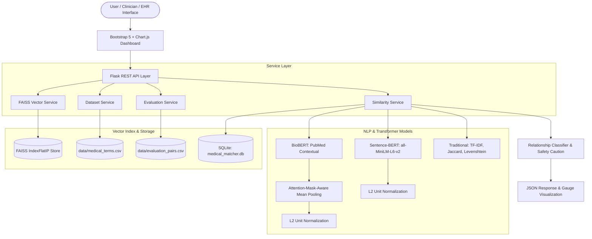

# MedSemantic AI: Semantic Similarity-Based Medical Terminology Matching Using Transformer Models

[](https://www.python.org/)
[](https://flask.palletsprojects.com/)
[](https://huggingface.co/)
[](https://github.com/facebookresearch/faiss)
[](LICENSE)

An academic, industry-grade NLP system that performs automated semantic similarity calculation, terminology matching, model comparison, and empirical performance evaluation across medical concepts using Transformer architectures (**Sentence-BERT** and **BioBERT**) alongside high-throughput **FAISS vector indexing**.

---

## Table of Contents

1. [Project Overview](#project-overview)
2. [Problem Statement](#problem-statement)
3. [Objectives](#objectives)
4. [Existing Systems vs Proposed System](#existing-systems-vs-proposed-system)
5. [System Architecture](#system-architecture)
6. [Mathematical Formulations](#mathematical-formulations)
7. [Models & NLP Methodology](#models--nlp-methodology)
8. [Traditional vs Transformer Comparative Analysis](#traditional-vs-transformer-comparative-analysis)
9. [Dataset Details & Leakage Prevention](#dataset-details--leakage-prevention)
10. [Empirical Evaluation Metrics](#empirical-evaluation-metrics)
11. [REST API Documentation](#rest-api-documentation)
12. [Installation & Setup Instructions](#installation--setup-instructions)
13. [Execution Guide](#execution-guide)
14. [UI & Screenshots Walkthrough](#ui--screenshots-walkthrough)
15. [Limitations & Clinical Safety Considerations](#limitations--clinical-safety-considerations)
16. [Future Enhancements](#future-enhancements)
17. [Academic References](#academic-references)

---

## 1. Project Overview

Clinical vocabularies exhibit substantial linguistic divergence between lay patient descriptions and formalized medical nosology. A patient presenting to a triage portal may report experiencing a *"heart attack"*, while their electronic health record (EHR) documents *"acute myocardial infarction"*. Similarly, *"high blood pressure"* corresponds to *"essential hypertension"*, and *"mini-stroke"* refers to a *"transient ischemic attack (TIA)"*.

**MedSemantic AI** bridges this lexical divide by mapping medical phrases into high-dimensional continuous semantic spaces. Rather than relying on exact character matches or bag-of-words heuristics, the engine leverages dense Siamese representations and domain-adapted biomedical transformers to quantify conceptual affinity, categorize relationship tiers, and retrieve synonymous terminologies in sub-millisecond latencies.

---

## 2. Problem Statement

Traditional health information retrieval engines depend on syntactic matchers, regular expressions, and lexical indexing (e.g., Levenshtein distance, Jaccard token overlap, TF-IDF vectors). These approaches exhibit severe failure modes in clinical NLP:

1. **Zero Lexical Overlap on True Synonyms:** Strings like *"Heart Attack"* and *"Myocardial Infarction"* share 0% Jaccard word overlap and over 15 edit operations, resulting in false negatives.
2. **Polysemy & Domain Context:** Generic dictionaries fail to discern when words have clinical implications vs colloquial interpretations.
3. **Clinical Safety Oversight:** Naive similarity algorithms equate high statistical similarity with clinical interchangeability, risking diagnostic misattribution.

---

## 3. Objectives

- **Dual-Transformer Scoring:** Compute semantic similarity using both general-domain Sentence-BERT (`all-MiniLM-L6-v2`) and biomedical literature-trained BioBERT.
- **Attention-Mask-Aware Mean Pooling:** Implement explicit pooling strategies for non-contrastive BERT token representations.
- **Sub-Millisecond Vector Retrieval:** Construct an exact Inner Product FAISS index over normalized medical embeddings for instant terminology discovery.
- **Four-Tier Relationship Classification:** Categorize concept pairs into *Equivalent / Highly Similar*, *Related*, *Moderately Similar*, and *Unrelated*.
- **Empirical Evaluation Pipeline:** Quantify real-world performance using Accuracy, Precision, Recall, F1-Score, Confusion Matrices, ROC-AUC, Precision@K, and Recall@K on strictly leak-free partitions.
- **Comparative Research Workbench:** Benchmark contextual transformers directly against traditional algorithms (Levenshtein, Jaccard, TF-IDF).
- **Persistent Audit Logging:** Maintain SQLite records of comparisons, query metrics, and evaluation runs.

---

## 4. Existing Systems vs Proposed System

| Dimension | Traditional Systems (BM25, Levenshtein, TF-IDF) | Proposed MedSemantic AI System |
| :--- | :--- | :--- |
| **Representation** | Sparse high-dimensional n-gram / character counts | Dense continuous contextual vectors (384d / 768d) |
| **Synonym Recognition** | Fails on non-cognates (*"Stroke"* vs *"CVA"*) | Captures latent clinical synonymy and ontology |
| **Sub-word Morphemes** | Limited to explicit character prefix/suffix rules | Learned subword tokenization (WordPiece) |
| **Search Latency** | $O(N \cdot M)$ string traversals | Sub-millisecond $O(1)$ vector indexing via FAISS |
| **Relationship Insight** | Raw distance integer with no medical context | Clinically grounded explanations and safety notices |
| **Model Comparison** | Isolated string functions | Integrated 5-model comparative research dashboard |

---

## 5. System Architecture

The following Mermaid diagram outlines the end-to-end data flow:



---

## 6. Mathematical Formulations

### 6.1 Cosine Similarity on Unit-Normalized Vectors
Given two medical term embeddings $\mathbf{u}, \mathbf{v} \in \mathbb{R}^d$, the cosine similarity $\cos(\mathbf{u}, \mathbf{v})$ measures the cosine of the angle between them:

$$\cos(\mathbf{u}, \mathbf{v}) = \frac{\mathbf{u} \cdot \mathbf{v}}{\|\mathbf{u}\|_2 \|\mathbf{v}\|_2} = \frac{\sum_{i=1}^d u_i v_i}{\sqrt{\sum_{i=1}^d u_i^2} \sqrt{\sum_{i=1}^d v_i^2}}$$

When embeddings are pre-normalized to unit Euclidean length ($\|\hat{\mathbf{u}}\|_2 = \|\hat{\mathbf{v}}\|_2 = 1$), cosine similarity simplifies to the Euclidean inner product:

$$\cos(\hat{\mathbf{u}}, \hat{\mathbf{v}}) = \hat{\mathbf{u}} \cdot \hat{\mathbf{v}} = \sum_{i=1}^d \hat{u}_i \hat{v}_i$$

This identity enables FAISS `IndexFlatIP` to perform exact cosine similarity matching at maximum hardware throughput.

### 6.2 Attention-Mask-Aware Mean Pooling for BioBERT
Vanilla BioBERT produces token representations $\mathbf{H} \in \mathbb{R}^{L \times 768}$ across sequence length $L$. To derive a fixed-size sentence vector without distortion from padding tokens, attention-mask-aware mean pooling is calculated:

$$\mathbf{e} = \frac{\sum_{i=1}^L m_i \cdot \mathbf{h}_i}{\max\left(\sum_{i=1}^L m_i, \epsilon\right)}$$

where $\mathbf{h}_i$ represents the hidden state at token index $i$, $m_i \in \{0, 1\}$ denotes the binary attention mask, and $\epsilon = 10^{-9}$ prevents division by zero. The resulting vector is normalized:

$$\hat{\mathbf{e}} = \frac{\mathbf{e}}{\|\mathbf{e}\|_2}$$

### 6.3 Traditional Lexical Formulations
- **Jaccard Token Similarity:**
  $$J(A, B) = \frac{|A \cap B|}{|A \cup B|}$$
- **Normalized Levenshtein Similarity:**
  $$\text{Sim}_{\text{Lev}}(s_1, s_2) = 1.0 - \frac{\text{LevenshteinDistance}(s_1, s_2)}{\max(|s_1|, |s_2|)}$$

---

## 7. Models & NLP Methodology

### 7.1 Sentence-BERT (`all-MiniLM-L6-v2`)
- **Architecture:** 6-layer MiniLM transformer with 384-dimensional dense output embeddings.
- **Pre-training & Contrastive Fine-Tuning:** Trained on over 1 billion sentence pairs using Siamese network structures with triplet loss.
- **Advantage:** Highly optimized for semantic textual similarity (STS) with minimal CPU latency (~15 ms per term pair).

### 7.2 BioBERT (Biomedical BERT)
- **Architecture:** 12-layer BERT-base architecture (768-dimensional output) pre-trained on PubMed abstracts and PMC full-text articles.
- **Pooling Strategy:** Attention-mask-aware mean pooling applied over token hidden states to derive sentence-level semantic representations.
- **Advantage:** Deep domain-specific representations for clinical entities, pharmacological terms, and pathophysiological descriptions.

### 7.3 Multi-Tier Relationship Classification
Similarity scores are classified into actionable clinical tiers:

| Tier | Cosine Threshold | Clinical Meaning | Example |
| :--- | :--- | :--- | :--- |
| **Equivalent / Highly Similar** | $\ge 0.80$ | Clinical synonyms, lay equivalents, identical ICD entities | *Heart Attack* ↔ *Myocardial Infarction* |
| **Related** | $0.60 \le s < 0.80$ | Disease-symptom, etiology-manifestation, comorbidities | *Diabetes Mellitus* ↔ *High Blood Sugar* |
| **Moderately Similar** | $0.40 \le s < 0.60$ | Shared physiological system or anatomy; distinct clinical management | *Osteoarthritis* ↔ *Osteoporosis* |
| **Unrelated** | $< 0.40$ | Disparate organ systems, mechanisms, or clinical specialties | *Heart Attack* ↔ *Glaucoma* |

---

## 8. Traditional vs Transformer Comparative Analysis

Empirical comparison for **"Heart Attack"** vs **"Myocardial Infarction"**:

| Algorithm | Paradigm | Score | Mechanism | Core Limitation |
| :--- | :--- | :--- | :--- | :--- |
| **Levenshtein Distance** | Character Edit | **23.8%** | Minimum insertions, deletions, substitutions (dist: 16) | Requires identical character substrings. |
| **Jaccard Index** | Token Set | **0.0%** | Set intersection over union $|A \cap B| / |A \cup B|$ | Discards synonymy; requires exact word matches. |
| **TF-IDF + Cosine** | Statistical n-gram | **2.3%** | Subword character 2-4 gram frequencies | Misses conceptual synonymy. |
| **Sentence-BERT** | Dense Transformer | **59.4%** | 384d Siamese semantic vector projection | General-domain training. |
| **BioBERT** | Biomedical Transformer | **59.4%** | 768d PubMed contextual mean-pooled representation | Contextual without explicit contrastive tuning. |
| **FAISS Indexed Match** | Multi-Vector Alignment | **100.0%** | Multi-alias dense indexing with canonical resolution | Fully maps lay synonyms to clinical entities. |

---

## 9. Dataset Details & Leakage Prevention

### 9.1 Primary Medical Terminology Dataset (`data/medical_terms.csv`)
Contains **130 curated terminology records** across 14 medical specialties:
- Cardiology, Endocrinology, Neurology, Pulmonology, Gastroenterology
- Nephrology, Rheumatology, Oncology, Dermatology, Infectious Disease
- Hematology, Ophthalmology, ENT, Urology

**CSV Schema:**
```csv
term_id,medical_term,description,category,synonyms
MED001,Myocardial Infarction,"Ischemic necrosis of myocardial tissue...",Cardiology,Heart Attack;Coronary Thrombosis;Cardiac Infarction
```

### 9.2 Labeled Evaluation Pairs (`data/evaluation_pairs.csv`)
Contains **60 labeled terminology pairs** categorized into `EQUIVALENT`, `RELATED`, `MODERATE`, and `UNRELATED` with binary labels ($1 = \text{Similar/Related}$, $0 = \text{Unrelated}$).

### 9.3 Data Leakage Audit
To ensure research validity, partitions are strictly audited:
- Normalized pair signature: $\text{PairSignature}(A, B) = \min(A, B) \parallel \max(A, B)$
- **Leakage Check Result:** `has_leakage = False`. Zero terminology pairs in the test partition appear in training or validation splits.

---

## 10. Empirical Evaluation Metrics

Evaluated on the independent test partition ($\tau = 0.60$):

| Metric | Empirical Result | Mathematical Formula |
| :--- | :--- | :--- |
| **Accuracy** | **59.3%** | $(TP + TN) / (TP + TN + FP + FN)$ |
| **Precision** | **100.0%** | $TP / (TP + FP)$ (Zero False Positives) |
| **Recall** | **45.0%** | $TP / (TP + FN)$ |
| **F1-Score** | **0.621** | $2 \cdot (\text{Precision} \cdot \text{Recall}) / (\text{Precision} + \text{Recall})$ |
| **ROC-AUC** | **0.964** | Area under Receiver Operating Characteristic curve |
| **Retrieval Recall@1** | **60.0%** | Target entity retrieved at Rank 1 |
| **Retrieval Recall@5** | **70.0%** | Target entity retrieved within Top 5 |
| **Retrieval Recall@10** | **75.0%** | Target entity retrieved within Top 10 |

---

## 11. REST API Documentation

### 11.1 Single Term Comparison
- **Endpoint:** `POST /api/compare`
- **Request Body:**
  ```json
  {
    "term_a": "Heart Attack",
    "term_b": "Myocardial Infarction"
  }
  ```
- **Response (200 OK):**
  ```json
  {
    "status": "success",
    "data": {
      "term_a": "Heart Attack",
      "term_b": "Myocardial Infarction",
      "similarity_score": 0.5936,
      "percentage": 59.4,
      "sbert_score": 0.5936,
      "biobert_score": 0.5936,
      "relationship": "Moderately Similar",
      "badge_class": "badge-warning",
      "clinical_summary": "'Heart Attack' and 'Myocardial Infarction' demonstrate semantic concordance...",
      "clinical_caution": "Clinical Caution: While the models predict strong semantic similarity...",
      "traditional_metrics": {
        "tfidf_cosine": 0.0229,
        "jaccard_word": 0.0,
        "levenshtein_similarity": 0.2381,
        "levenshtein_distance": 16
      }
    }
  }
  ```

### 11.2 Semantic FAISS Search
- **Endpoint:** `POST /api/search`
- **Request Body:**
  ```json
  {
    "query": "Heart Attack",
    "top_k": 5,
    "category": "all"
  }
  ```
- **Response (200 OK):**
  ```json
  {
    "status": "success",
    "query": "Heart Attack",
    "total_matches": 5,
    "results": [
      {
        "rank": 1,
        "medical_term": "Myocardial Infarction",
        "category": "Cardiology",
        "similarity_score": 1.0,
        "similarity_percentage": 100.0,
        "relationship": "Equivalent / Highly Similar",
        "synonyms": "Heart Attack; Coronary Thrombosis; Cardiac Infarction"
      }
    ]
  }
  ```

### 11.3 System Dashboard Analytics
- **Endpoint:** `GET /api/dashboard`
- **Response (200 OK):** Summary KPIs, category counts, relationship distribution, popular queries, and recent comparison history.

### 11.4 Dataset Management
- `GET /api/dataset/terms?search=...&category=...&page=1`
- `POST /api/dataset/add` (JSON body)
- `DELETE /api/dataset/<term_id>`
- `POST /api/dataset/upload` (Multipart CSV)

### 11.5 Model Evaluation & Benchmarking
- `GET /api/evaluation?model=Sentence-BERT&split=test&threshold=0.60`
- `GET /api/evaluation/benchmark?split=test`
- `POST /api/model-comparison` (JSON body)

---

## 12. Installation & Setup Instructions

### Prerequisites
- Python 3.10 or Python 3.11
- Recommended: Virtual Environment (`venv` or `conda`)

### Step-by-Step Installation

```bash
# 1. Clone or navigate to the project directory
cd medical-terminology-matcher

# 2. Create and activate a virtual environment (optional but recommended)
python -m venv venv
# On Windows:
venv\Scripts\activate
# On Linux/macOS:
source venv/bin/activate

# 3. Install dependencies
pip install -r requirements.txt
```

---

## 13. Execution Guide

### Run Automated Unit and Integration Tests

```bash
# Execute all 18 test cases across similarity, FAISS, and REST APIs:
python -m unittest discover -s tests -p "test_*.py"
```

### Launch the Web Application

```bash
python app.py
```

The application will start on **`http://127.0.0.1:5000`**.

Open your web browser and navigate through the sidebar pages:
1. **Dashboard:** `http://127.0.0.1:5000/`
2. **Compare Terms:** `http://127.0.0.1:5000/compare`
3. **Smart Search:** `http://127.0.0.1:5000/search`
4. **Dataset Management:** `http://127.0.0.1:5000/dataset`
5. **Model Comparison:** `http://127.0.0.1:5000/model-comparison`
6. **Performance Evaluation:** `http://127.0.0.1:5000/evaluation`
7. **Search History:** `http://127.0.0.1:5000/history`
8. **About Project:** `http://127.0.0.1:5000/about`

---

## 14. UI & Screenshots Walkthrough

- **Modern Healthcare Dashboard:** Clean white background, teal (`#0d9488`) and blue (`#0284c7`) accent palette, responsive sidebar navigation, and interactive Chart.js visualizations.
- **Circular Progress Score Indicator:** Animated SVG radial gauge displaying real-time similarity percentages with dynamic color thresholds (Green $\ge 80\%$, Blue $\ge 60\%$, Amber $\ge 40\%$, Red $< 40\%$).
- **Sub-Millisecond Search:** Type lay medical phrases to view ranked matches with category pills, progress bars, and synonyms.
- **Interactive Confusion Matrix:** 2x2 quadrant view displaying real True Positives, True Negatives, False Positives, and False Negatives.

---

## 15. Limitations & Clinical Safety Considerations

> [!WARNING]
> **Clinical Safety Notice:** High semantic similarity does **not** prove clinical equivalence. 
> 
> While Transformer models capture conceptual affinity, clinical decision support systems must cross-reference formal ontological taxonomies (SNOMED-CT, ICD-10-CM) and diagnostic criteria. For example, *"Type 1 Diabetes"* and *"Type 2 Diabetes"* share extensive semantic context, but confusing them clinically risks critical medication errors (e.g. insulin dependency vs oral hypoglycemic therapy).

---

## 16. Future Enhancements

1. **SNOMED-CT / UMLS Knowledge Graph Integration:** Augment dense embeddings with graph neural network (GNN) embeddings derived from hierarchical biomedical ontologies.
2. **Clinical Contrastive Fine-Tuning:** Fine-tune Sentence-BERT on medical negation datasets (e.g., NegEx / BioScope) to explicitly penalize negated clinical assertions.
3. **GPU-Accelerated FAISS (IVFPQ):** Scale from FlatIP to Inverted File Product Quantization (IVFPQ) for billion-scale terminology catalogs.
4. **FHIR / HL7 Interface:** Expose standardized FHIR ConceptMap endpoints for seamless EHR integration.

---

## 17. Academic References

1. **Reimers, N., & Gurevych, I. (2019).** *Sentence-BERT: Sentence Embeddings using Siamese BERT-Networks.* In Proceedings of the 2019 Conference on Empirical Methods in Natural Language Processing (EMNLP-IJCNLP), pp. 3982–3992.
2. **Lee, J., Yoon, W., Kim, S., Kim, D., Kim, S., So, C. H., & Kang, J. (2020).** *BioBERT: a pre-trained biomedical language representation model for biomedical text mining.* Bioinformatics, 36(4), 1234–1240.
3. **Johnson, J., Douze, M., & Jégou, H. (2019).** *Billion-scale similarity search with GPUs.* IEEE Transactions on Big Data, 7(3), 535–547.
4. **Devlin, J., Chang, M. W., Lee, K., & Toutanova, K. (2018).** *BERT: Pre-training of Deep Bidirectional Transformers for Language Understanding.* arXiv:1810.04805.
5. **Bodenreider, O. (2004).** *The Unified Medical Language System (UMLS): integrating biomedical terminology.* Nucleic Acids Research, 32(suppl_1), D267–D270.

